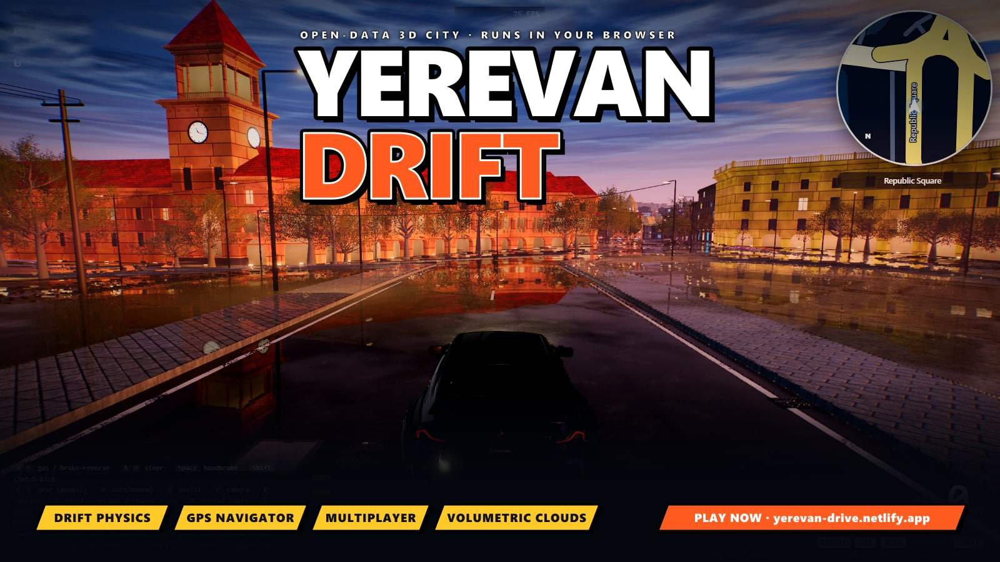
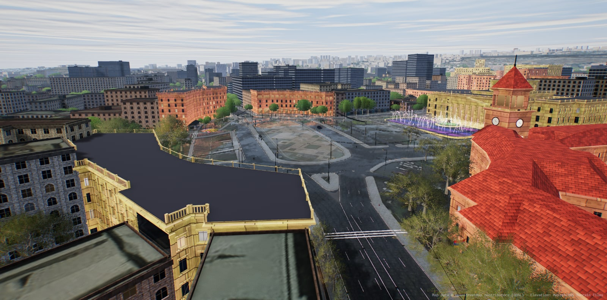
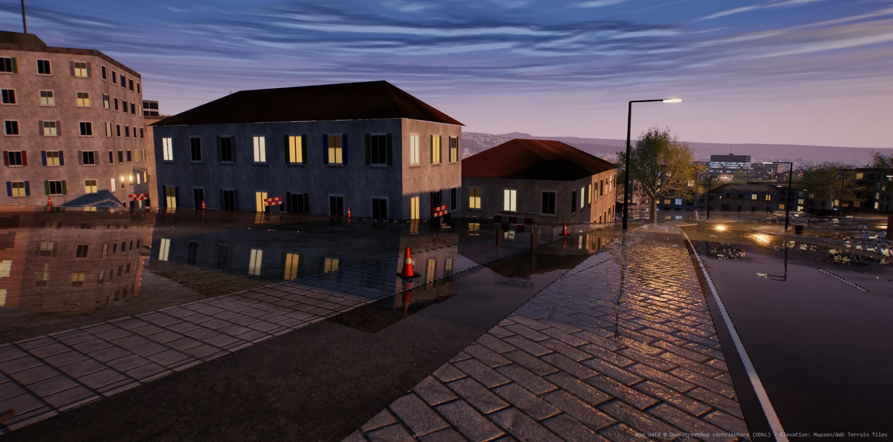
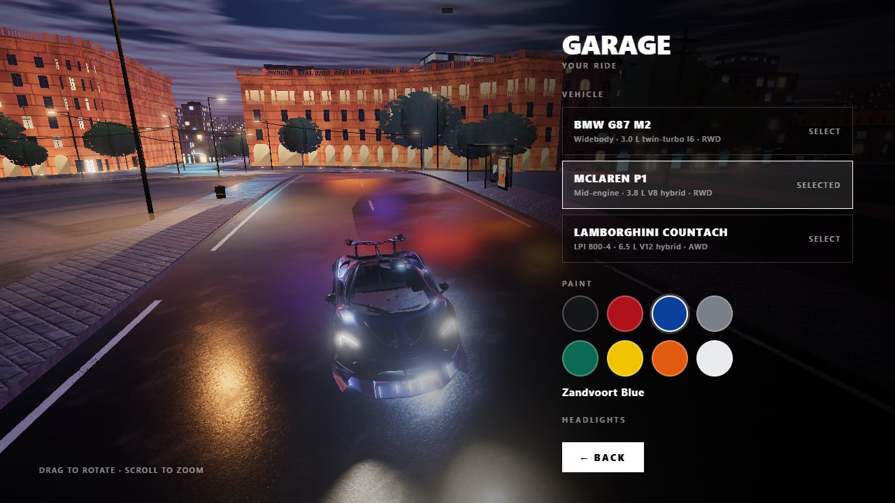
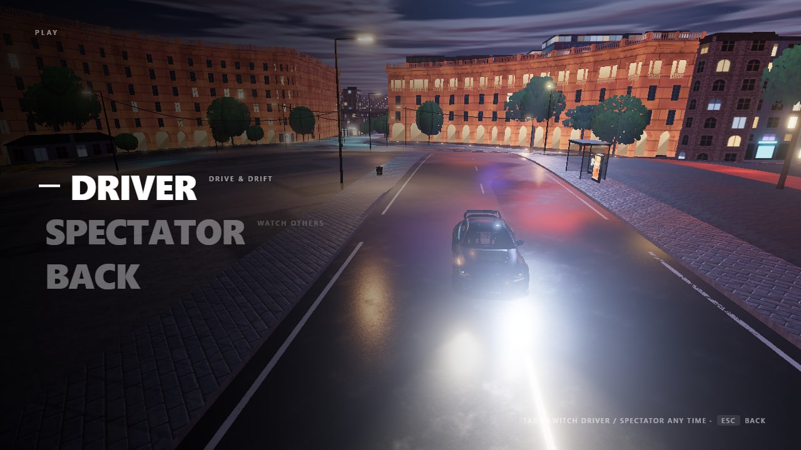
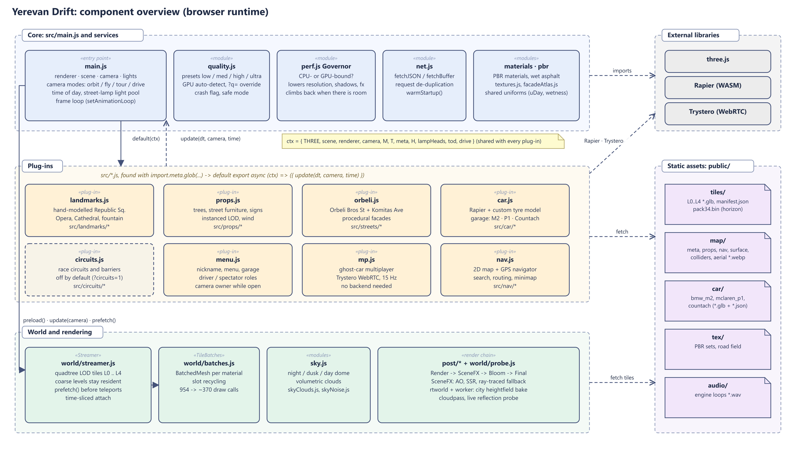

<p align="center">
  <a href="https://yerevan-drive.netlify.app"></a>
</p>

<h1 align="center">Yerevan Drift</h1>

<p align="center">
  <b>Drive, drift and fly through central Yerevan, right in your browser.</b><br>
  A 3D city built from real OpenStreetMap data and aerial imagery, with a drift-physics car, a GPS navigator and online multiplayer.<br>
  Everything runs client-side: no backend, nothing to install for players.
</p>

<p align="center">
  <b><a href="https://yerevan-drive.netlify.app">&#9654; Play now: yerevan-drive.netlify.app</a></b>
</p>

<p align="center">
  <a href="#get-the-game">Get the game</a> ·
  <a href="#preview">Preview</a> ·
  <a href="#features">Features</a> ·
  <a href="#controls">Controls</a> ·
  <a href="#how-it-works-uml">Architecture</a> ·
  <a href="#data--licensing">Licensing</a>
</p>

---

## Get the game

### Play instantly in your browser
Open **<https://yerevan-drive.netlify.app>**: nothing to download or install. Everyone who opens it lands in the same online room, so you will see other drivers. The first load streams the city tiles and compiles shaders, so give the loading bar a moment.

### Or run your own copy
The map is a Vite + three.js web app. The baked map data (`public/`, about 240 MB) is committed, so a fresh copy runs as is and you do **not** have to rebuild anything.

**You need** [Node.js](https://nodejs.org/) 22 or newer, [Git](https://git-scm.com/) (or just a browser to download the ZIP) and a desktop browser with WebGL2. A dedicated GPU is strongly recommended; the game picks a quality preset for your machine automatically.

### Option 1: clone with Git (recommended)
```
git clone https://github.com/AstwareDev/YerevanDrive.git
cd YerevanDrive
npm install
npm run dev
```
Then open the address Vite prints (usually <http://localhost:5173>). The first load streams the city tiles and compiles shaders, so give it a moment: the loading bar shows progress.

> The full history is large (the repository holds the raw source data). If you only want to play, add `--depth 1` to `git clone` to skip the history.

### Option 2: download a ZIP (no Git)
1. Open <https://github.com/AstwareDev/YerevanDrive>, press the green **Code** button and choose **Download ZIP** (direct link: <https://github.com/AstwareDev/YerevanDrive/archive/refs/heads/main.zip>).
2. Unzip it, open a terminal in the unzipped folder and run `npm install`, then `npm run dev`.

### Play online with friends
Open the same address in several tabs or browsers: every tab is a driver. For a private room use `?room=myfriends` (for example `http://localhost:5173/?room=myfriends`). To let people on the internet join you, deploy the site (see [Multiplayer + deploying to Netlify](#multiplayer--deploying-to-netlify)), or just share the live site above.

### Other commands
```
npm run build    # production bundle in dist/ (static files, host anywhere)
npm run build:all  # re-bake all map data (only needed if you change the data or the generators, see "Rebuild the data")
```

## Preview

<table>
  <tr>
    <td width="50%"><br><sub><b>Free camera over Republic Square</b>, day mode (<kbd>T</kbd> cycles night, dusk, day)</sub></td>
    <td width="50%"><br><sub><b>Golden hour at street level</b>: wet asphalt, lit windows, reflections</sub></td>
  </tr>
  <tr>
    <td width="50%"><br><sub><b>Garage</b>: BMW M2, McLaren P1, Lamborghini Countach and 8 paints</sub></td>
    <td width="50%"><br><sub><b>Menu</b>: play as a driver or watch the others as a spectator</sub></td>
  </tr>
</table>

<sub>Screenshots taken on the Ultra preset during development; the look changes a little as the city gets more detail.</sub>

## Features

- **Real city, real streets.** Republic Square and its surroundings from OpenStreetMap, real terrain heights and aerial photo textures. The detailed area runs from Republic Square to Marshal Baghramyan Ave, Orbeli Brothers St, Barekamutyun metro and Komitas Ave, and the rest of Yerevan is streamed as distant LOD tiles out to the horizon.
- **Hand-modelled landmarks.** Government House with the clock tower, History Museum and National Gallery, the singing fountains, Northern Avenue, the Opera House and St Gregory Cathedral, plus procedural facades along Orbeli and Komitas.
- **Drift car.** Rapier handles collisions; the tyres, engine, gearbox and assists are our own physics. Three garage cars (BMW G87 M2 widebody, McLaren P1, Lamborghini Countach), paints, four cameras, gamepad with rumble, drift scoring.
- **Showroom garage.** The menu's Garage opens a dedicated warehouse hall (`src/garage.js`): a centred switcher for the cars and the helicopter, and on the left paint (8 swatches + any colour), finish (gloss / metal / satin / matte), headlights, showroom lighting, turntable and performance stats. Everything is remembered between visits.
- **Flyable helicopter.** Pick the Sikorsky SH-60B Seahawk in the garage and press Play. Own flight model (`src/heli/flight.js`: rotor thrust, ground effect, translational lift, drag, torque reaction, wheel contacts), collisions with the buildings, rotor strikes, three cameras, a flight HUD with artificial horizon, procedural rotor audio and an assisted / raw flight mode. `npm run sim:heli` flies it headless.
- **Day, dusk and night.** Wet or dry asphalt, neon, street-lamp light, a night sky with Ararat on the horizon and volumetric clouds you can fly through.
- **Ultra graphics, scalable down.** Ambient occlusion, screen-space plus ray-traced reflections, a live reflection probe and tile batching. Four quality presets and a governor that lowers settings when the frame rate drops, so it also runs on weak PCs.
- **GPS navigator.** Press <kbd>F</kbd> for a map with address and place search, turn-by-turn guidance, a minimap and voice prompts.
- **Multiplayer without a server.** Peer-to-peer WebRTC (ghost cars, name tags, online list) that works on a static host.

## Controls

**Helicopter** (when the Seahawk is the selected vehicle): <kbd>W</kbd><kbd>S</kbd> cyclic pitch · <kbd>A</kbd><kbd>D</kbd> bank · <kbd>Q</kbd><kbd>E</kbd> (or <kbd>←</kbd><kbd>→</kbd>) yaw pedals · <kbd>Space</kbd>/<kbd>↑</kbd> climb · <kbd>Shift</kbd>/<kbd>↓</kbd> descend · <kbd>I</kbd> engine · <kbd>G</kbd> flight assist / raw · <kbd>L</kbd> lights · <kbd>C</kbd> camera · <kbd>R</kbd> respawn. Gamepad: left stick yaw + climb, right stick cyclic.

**Car:**

| Key | Action |
|---|---|
| <kbd>W</kbd> <kbd>S</kbd> <kbd>A</kbd> <kbd>D</kbd> | throttle / brake, steer (fly camera: move) |
| <kbd>Space</kbd> · <kbd>Shift</kbd> | handbrake · clutch-kick |
| <kbd>C</kbd> · <kbd>R</kbd> · <kbd>J</kbd> | change camera · respawn · jump to a named street |
| <kbd>F</kbd> | map, search and GPS |
| <kbd>Tab</kbd> · <kbd>Esc</kbd> | switch driver / spectator · menu |
| <kbd>T</kbd> | night, dusk, day |
| <kbd>1</kbd> <kbd>2</kbd> <kbd>3</kbd> <kbd>4</kbd> | orbit, fly, drive tour, drive |

The full list (gears, assists, paint, lights, sound, gamepad) is in [Driving](#driving-srccarjs--srccar) and [Gamepad / joystick](#gamepad--joystick). Handy URL options: `?q=low|med|high|ultra` (quality), `?mp=0` (no multiplayer), `?room=name` (private room), `?clouds=0|1|2`, `?circuits=1`, `?cars=1`.

## How it works (UML)


`src/main.js` owns the renderer, camera modes and the frame loop, and auto-loads independent **plug-ins** (landmarks, props, car, map/GPS, multiplayer, menu). The map itself is baked offline by the scripts in `tools/` and streamed as LOD tiles at run time.

Full UML set in **[docs/ARCHITECTURE.md](docs/ARCHITECTURE.md)**: start-up and per-frame sequence diagrams, car and streaming class diagrams, the menu / camera state machine and the build-time data pipeline. Regenerate the images with `npm run docs:diagrams`.

## Rebuild the data (order matters)
Only needed if you change the data or the generators: the baked files in `public/` are already committed. `npm run build:all` runs the baking tools in the right order (orbeli → landmarks → map → tiles → props → clean-onroad → car → nav). Individual steps:

```
npm run data              # OSM (Overpass) + elevation (AWS Terrain Tiles)           -> data/
npm run data:far          # far-field OSM chunks, coarse heights, far imagery        -> data/osm_far, public/map/aerial_*.webp
npm run imagery           # aerial mosaics                                           -> public/map/aerial*.webp
npm run build:textures    # PBR texture library (needs data/tex_raw from ambientCG)  -> public/tex/
npm run build:landmarks   # hand-modelled landmark footprints + skip list            -> public/map/lm/, data/landmark-skip.json
npm run build:map         # terrain, roads, colliders, meta, AO                      -> public/map/*
npm run build:tiles       # streaming LOD tiles L0..L4 + the packed horizon file     -> public/tiles/
npm run build:props       # vegetation, street furniture, lamps, neon placement      -> public/map/props.json
npm run clean:road        # drop props that landed on the carriageway
npm run build:car         # BMW M2 game asset (other cars: tools/build-car-pack.mjs) -> public/car/
npm run build:nav         # road graph + search index + satellite basemap            -> public/map/nav.json
npm run build:lowres      # half-resolution photo layers for the Low / Med presets
npm run sim:car           # headless car physics harness (tuning)
npm run test:nav          # headless router check
```
The *Extended city* section further down has the fetch order for the larger free-drive region.

## Layout
- `tools/build-map.mjs` – terrain, roads (lane markings, sidewalks, crossings), parks/plazas/water, extruded buildings in 4 facade styles (tuff, panel, glass tower, house), hipped roofs detected from the aerial photo, parapets/cornices, neon signs, walls, lamps, baked contact-AO. Local frame: x east, y up (0 = square), z south.
- `tools/build-landmarks.mjs` + `src/landmarks*` – Republic Square ensemble (Government House + clock tower, History Museum/National Gallery, Marriott, Post, Foreign Ministry), animated singing fountains, Northern Avenue, Opera House, St Gregory Cathedral. Not built: Cascade and Karen Demirchyan complex (outside the ±1 km terrain).
- `tools/build-props.mjs` + `src/props*` – 6 tree species with leaf cards + wind, bushes/hedges, ~4k parked cars, signalised junctions with animated lights, signs, bus shelters, kiosks, flags, rooftop signs.
- `src/` – procedural PBR textures, wet-asphalt/aerial/AO shader patch (`materials.js`), sky (stars, moon, sun, Ararat silhouette at its true bearing), time of day, shadows, bloom with a NaN-safety pass.
- Plug-ins (`landmarks.js`, `props.js`) are auto-loaded by `main.js` and receive `{ THREE, scene, renderer, camera, M, T, meta, H, lampHeads, tod }`; read `tod.night` (0..1) to dim emissive things in daylight.
- `public/map/height.bin/json` – 5 m height grid; `src/height.js` / `tools/terrain.mjs` expose `H(x,z)` for physics.

## Data & licensing
- Map data © OpenStreetMap contributors (ODbL) — keep the attribution.
- Elevation: Mapzen/AWS Terrain Tiles.
- **Aerial imagery: Esri World Imagery, fetched for prototyping only.** Check the provider's terms before shipping; replace `TILE_URL` in `tools/fetch-imagery.mjs` with a licensed source (Mapbox, Maxar, local survey) for release.

## Driving (src/car.js + src/car/*)

The map now has a playable drift car (BMW G87 M2 widebody). It starts on the *Republic Loop* grid; `Tab` swaps between driving and the free cameras.

| Key | Action |
|---|---|
| W / S | throttle / brake, reverse when stopped |
| A / D | steer |
| Space | handbrake (clutch is disengaged while held) |
| Shift | clutch-kick (torque spike to break the rear loose) |
| E / Q, M | shift up / down in manual mode, toggle auto / manual |
| G | assists on/off (auto counter-steer, drift-angle stability torque, drift throttle, launch control) · V ABS |
| C | camera (chase, far, hood, cockpit) · R respawn · P paint · L lights · F2 sound · O wet/dry · T day/night |

* **Physics**: Rapier owns the rigid body and all collisions; the car dynamics are ours (`car/vehicle.js`): 4 spring/damper corners over the analytic ground
  (`H(x,z)` + a 0.5 m surface raster with curbs/sidewalks, `car/ground.js`), combined-slip tyre model with load sensitivity and relaxation length, RWD drivetrain with
  torque curve, 6-speed gearbox, locked-ish rear diff, aero, belly/roof scrape springs. Tune everything in the `CAR` constants at the top of that file.
* **World colliders** (`car/colliders.js`): building footprints, OSM walls/fences, circuit barriers (tyres/jersey/armco), trees, lamp poles, bollards and parked cars are
  bucketed in 96 m cells and streamed into Rapier as one triangle-mesh collider per cell around the car. Data comes from `public/map/colliders.json` and
  `surface.bin/json`, both written by `tools/build-map.mjs`.
* **Car model**: `node tools/build-car.mjs` turns `data/car/bmw_m2.glb` (Sketchfab FBX export, 271k tris) into `public/car/bmw_m2.glb` (3 MB, 241k tris): bakes the 0.01 FBX scale,
  drops the engine and the stock body, splits wheels into `steer_XX` → `spin_XX` nodes, removes transmission, renames the paint material to `paint`.
* **FX / audio / HUD**: `car/fx.js` (skid-mark ribbons, tyre smoke, sparks), `car/audio.js` (procedural engine/turbo/pops/tyres/wind, no sample files),
  `car/hud.js` (gauges + drift scoring: angle × speed × combo, near-wall and transition bonuses).
* **Headless tuning**: `npm run sim:car -- kick|hb|hold|circle|corner|accel` runs the vehicle on a flat road in Node and prints slip angle / yaw rate time series.

**Audio samples**: `public/audio/eng_*.wav` are ElevenLabs-generated engine loops (idle / ~3k / ~5k / ~7k rpm, loop-crossfaded and loudness-matched with SenseMCP) plus an off-throttle overrun burst.
`car/audio.js` cross-fades them by rpm and pitches them with `playbackRate`, and keeps the synthesized engine underneath so the pitch stays exact. Raw downloads are in `data/audio_raw/`.
Parked cars are off by default (clear roads); `?cars=1` restores them and their colliders.

## Gamepad / joystick
Plug in a controller (Xbox / PlayStation / most USB pads; Chrome and Edge need one button press before the page sees it). Left stick steers, **RT** gas, **LT** brake/reverse, **A** handbrake, **X** clutch-kick, **LB/RB** gears, **Y** camera, **B** respawn (closes the map), D-pad = auto/manual, assists, lights, paint, **Start** map, **Back** free camera, **L3** cancel route, **R3** quick teleport. In the map the left stick pans and the triggers zoom. Rumble on tyre slip, rev limiter and impacts. Generic joysticks/wheels: X axis steers, Y axis gas/brake, buttons 0-3 = handbrake / kick / camera / respawn. Keyboard and pad can be used together. Code: `src/car/input.js`.

## Sky
`src/sky.js`: night / dusk (golden hour) / day, with procedural banded cloud decks that drift with the wind and are lit by the sun or moon (dark blue deck with a golden gap at dusk, city-glow violet at night). **T** cycles night -> dusk -> day; `uCover` in the sky material sets cloud amount.

**Volumetric clouds (High / Ultra).** A slab 1.8-4 km above the camera is ray-marched through a tileable 3D noise texture (`src/skyNoise.js`, 64^3, generated in small CPU slices in the background; the 2D clouds show until it is ready, then cross-fade) with Beer-Lambert extinction, a two-lobe Henyey-Greenstein phase (silver lining), a short march towards the sun/moon for self-shadowing, bump shading of the lumps, flat bellies / rounded tops and a height-based ambient. Clouds are in world space (parallax while driving) and drift with the wind. **Free camera:** the layer is a real slab 1.8-4 km above the ground. Below it the sky dome draws the clouds; once the camera reaches 1.8 km (free camera / orbit, **E** climbs and flight speed grows with altitude) `src/post/cloudpass.js` composites the same march over the scene using the depth buffer, so you can fly into the mist and look down on the cloud deck with the city beneath (costs nothing at street level). Ultra = 22 steps + 3 light taps, High = 12 steps + 2, reflection-probe faces use a rough 6-step pass; Low / Med keep the 2D decks. Override with `?clouds=0|1|2` (0 = 2D, 1 = High, 2 = Ultra) to compare or if a GPU struggles. To preview the look without a GPU/browser: `node tools/sim-clouds.mjs out.png <day 0..1> <yaw> <pitch>` (CPU port of the march, kept in sync by hand with `volClouds` in `src/skyClouds.js`; optional last argument = camera altitude, e.g. 2600 inside the layer, 6000 above it).

## Multiplayer + deploying to Netlify
Every browser tab is a player; everyone sees everyone's car (ghost cars, no player-vs-player collisions), name tags, an *ONLINE* list (click your own row to rename) and the other drivers on the minimap / map.
`src/mp.js` sends the car state at 15 Hz over serverless WebRTC (Trystero; public Nostr relays are only used to find peers) plus a BroadcastChannel for tabs of the same browser, so **no backend is needed**. Default room is `public`; `?room=friends` makes a private one, `?mp=0` turns it off.
Deploy: `npm run build` then upload `dist/` (`netlify deploy --prod --dir=dist`, or connect the repo: `netlify.toml` is included). The site is ~235 MB of baked map data, mostly streamed on demand.
Limits: players behind strict NATs/corporate firewalls may not connect (no TURN server); works well up to roughly 10-15 drivers per room (full mesh).

## Map, search & GPS navigator
Press **F** (or the *Map* button) at any time:

* **Search** an address, street, house number (`Abovyan 12`), or a place (`Cascade`, `metro`); Armenian, English and Russian names all work and spelling variants (Baghramyan / Bagramyan) are tolerated. Category chips list the nearest metro stations, food, parks, hotels, shops, culture. *Enter* with no local match falls back to the Photon geocoder over OpenStreetMap (online, only on Enter; the typed text is the only thing sent).
* The result is shown on the **2D map** (dark vector map or satellite, pan / zoom / click to drop a pin) **and in the 3D world** as a light beam + floating label.
* **Navigate** starts turn-by-turn guidance from the car: heading-up minimap, turn card (arrow, distance, street, remaining distance / ETA), a glowing route ribbon painted on the road ahead, voice prompts (toggle in the map panel), automatic re-routing. **X** cancels the route. **Teleport car** drops the car on the nearest road; **View in 3D** flies the free camera there (Tab returns to the car).

Data: `node tools/build-nav.mjs` -> `public/map/nav.json` (road graph, search index, footprints) and `public/map/nav_aerial.webp` (satellite basemap). Code: `src/nav.js` (plug-in), `src/nav/{data,search,mapview,world3d,ui,geo}.js`. `node tools/test-nav.mjs` checks routing headlessly.

## Extended city (free-drive region)

The full-detail (L0) map is no longer 2 km x 2 km: `REGION` in `tools/config.mjs` (x -2560..1024, z -3584..1024, tile aligned) covers Republic Square plus
Marshal Baghramyan Ave, Orbeli Brothers St, Barekamutyun metro and Komitas Ave (252 L0 tiles, ~4.8 M triangles, ~105 MB of tiles; only tiles near the car are streamed).
Beyond it the usual far LOD tiles (L1 now reaches +-4096 m) carry the rest of Yerevan. `J` in the game teleports to the named streets (`places` in `public/map/meta.json`).

* `NEAR` (centre -768/-1280, half-size 2304 m) is the shared window of the aerial mosaic (`public/map/aerial.webp`, Esri z17), the contact-AO map and the road field. It is hard-coded in `src/materials.js` and `src/world/farMaterials.js` too.
* The fine 5 m height grid is now +-3800 m (`FINE_R`); the drivable surface raster (`public/map/surface.bin/json`) is cropped to the region (0.5 m cells, ~70 MB in memory).
* Rebuild order: `node tools/fetch-region.mjs` (fine OSM detail in 1 km chunks, merged with `data/osm_far` into `data/osm.json`; the old file is kept as `data/osm_center.json`) →
  `node tools/fetch-data.mjs` (height grid, OSM is skipped when present) → `node tools/fetch-imagery.mjs 17 2304 public/map/aerial.webp -768 -1280` → `node tools/build-textures.mjs roadfield` →
  `node --max-old-space-size=20000 tools/build-map.mjs` (~15 min) → `tools/build-props.mjs` → `tools/build-tiles.mjs`.
* Lamp glow pools are scaled down where lamps are dense (long avenues), otherwise the additive pools washed the whole road out.

## Performance & memory (weak PCs, tablets)

- **Presets** (`src/quality.js`): `low / med / high / ultra`. Besides resolution/shadows each one has a *pixel budget* (max internal pixels, so a 1440p monitor
  on Ultra is no longer rendered as 4K + 4x MSAA), a point-light pool size (`lights`, paid per pixel in every lit material), a shadow-map refresh rate
  (`shadowEvery`) and photo-layer sizes (`aerial`). `?pr=1.0` forces a render scale, `?lights=N`, `?shadowEvery=N`, `?msaa=N` override single knobs.
- **Auto mode** picks the preset from the GPU name, core count, device memory and touch input. If the previous start died while loading (OOM / GPU reset) the
  next start is capped one tier lower ("safe mode" in the fps box); picking a level in Settings > Graphics lifts the cap. A lost WebGL context does the same.
- **Governor** (`src/perf.js`): works out whether the frame is CPU- or GPU-bound, lowers resolution / shadow refresh / draw distance / effects in that order,
  climbs back up when there is headroom, remembers what it learned per preset, and shows what it changed under the fps counter.
- **Streaming** (`src/world/streamer.js`): coarse tiles (L2+) stay resident so a teleport always has terrain under it; L3-L4 come from one pack file
  (`node tools/pack-tiles.mjs`); map selection / teleport call `drive.prefetch(x, z)`; tile attach is time-sliced per mesh.
- **Assets**: `node tools/make-lowres.mjs` writes the half-resolution photo layers (`*.2k.webp`, `roadfield.2k.png`) used by Low/Med; PBR texture sets are capped at 1K
  except the hero surfaces (road, pavement, plaza, main facades) in `src/pbr.js`.
- Not done yet (biggest remaining wins): KTX2/Basis GPU texture compression (needs an encoder), moving GLB parsing + batching into a Worker, TAA/FSR-style upscaling.
