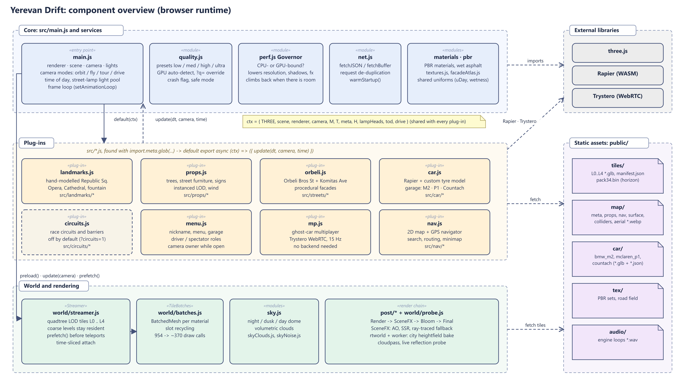
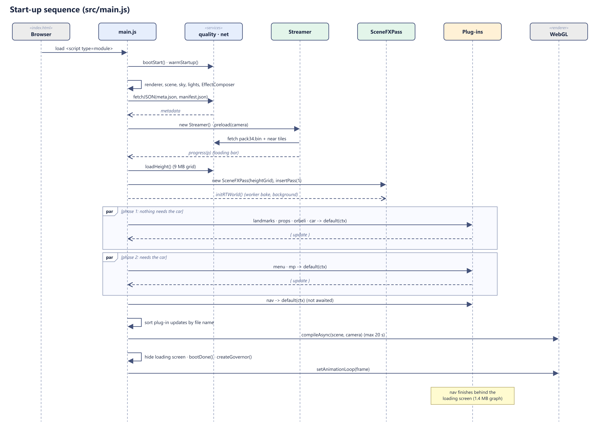
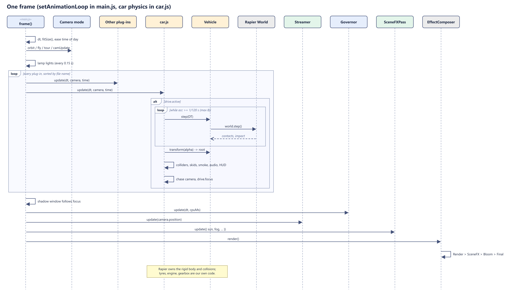
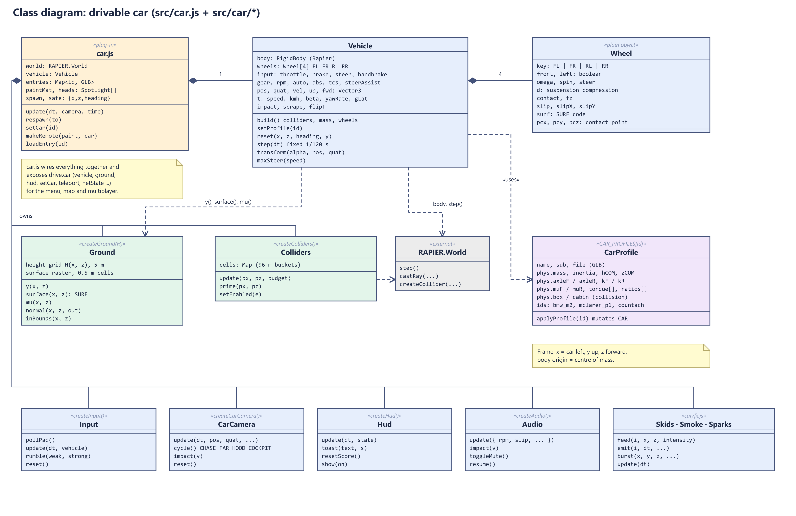
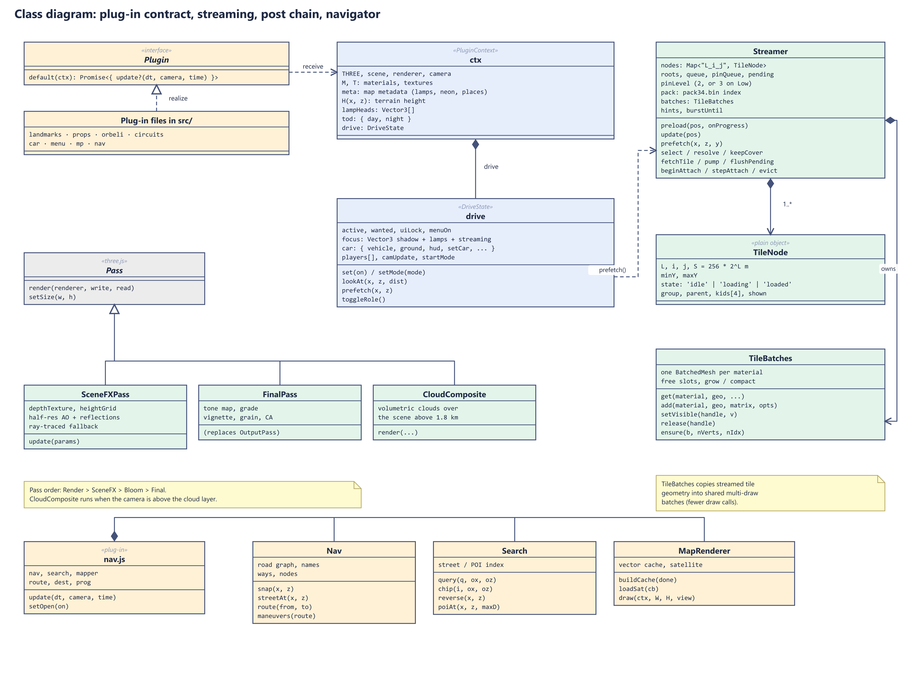
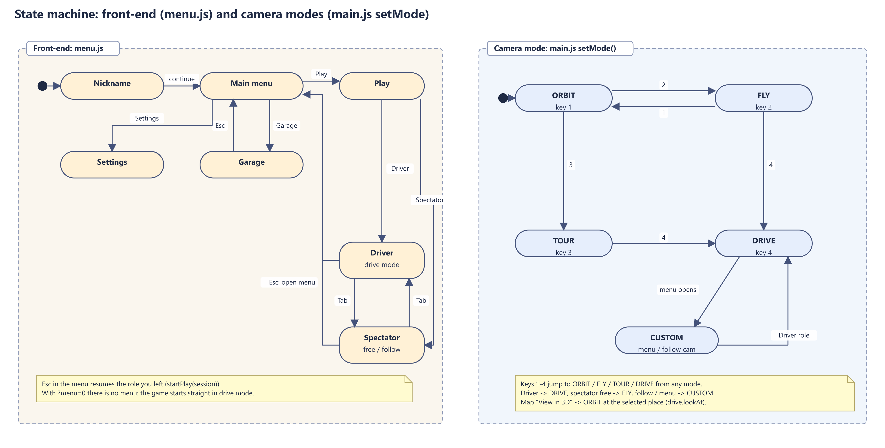
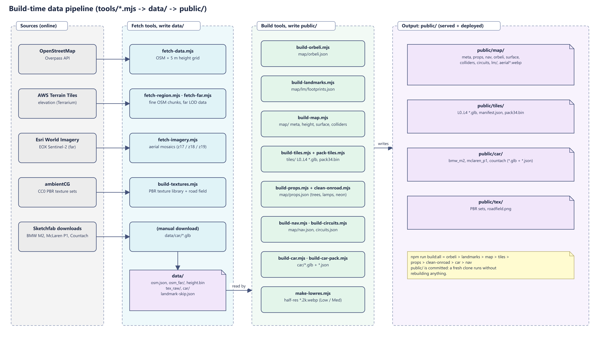

# Architecture (UML)

How Yerevan Drift is put together, drawn as UML. Every diagram is generated from `tools/diagrams/build.mjs`, so they can be regenerated when the code changes (see [Regenerating the diagrams](#regenerating-the-diagrams)).

| # | Diagram | UML type | Answers |
|---|---|---|---|
| 1 | [Components](#1-component-overview) | Component | What are the big parts and who talks to whom? |
| 2 | [Start-up](#2-start-up-sequence) | Sequence | What happens between opening the page and the first frame? |
| 3 | [One frame](#3-one-frame) | Sequence | What runs every frame, and where does the car physics fit? |
| 4 | [Car](#4-class-diagram-drivable-car) | Class | How is the drivable car built? |
| 5 | [Plug-ins, streaming, post, nav](#5-class-diagram-plug-ins-streaming-post-chain-navigator) | Class | What is the plug-in contract, and how are tiles streamed? |
| 6 | [Modes and menu](#6-state-machine-front-end-and-camera-modes) | State machine | How do menu roles map to camera modes? |
| 7 | [Data pipeline](#7-build-time-data-pipeline) | Flow | How does OpenStreetMap data become the 3D map? |

## 1. Component overview



`src/main.js` is the only entry point. It owns the renderer, the camera modes, time of day and the frame loop, and it **discovers every plug-in with `import.meta.glob`**. Plug-ins are independent files in `src/`. Each one default-exports `async (ctx) => ({ update(dt, camera, time) })`, so adding a feature usually means adding one file, not editing `main.js`.

- **Core services:** `quality.js` (presets, crash recovery), `perf.js` (the Governor that lowers or raises quality to hold the frame rate), `net.js` (cached fetches), `materials.js` / `pbr.js` / `textures.js` (shared PBR look).
- **World and rendering:** `world/streamer.js` streams a quadtree of LOD tiles, `world/batches.js` merges them into few draw calls, `post/*` is the effect chain (AO, reflections, clouds, tone mapping).
- **Assets:** everything under `public/` is baked ahead of time by the build tools (diagram 7) and fetched at run time.

## 2. Start-up sequence



Start-up is ordered so that the loading screen is as short as possible:

1. `warmStartup()` starts every download in parallel before any code needs the data.
2. `Streamer.preload()` loads the horizon (`pack34.bin`) and the tiles around the camera.
3. Plug-ins load in **two phases**. Phase 1 (landmarks, props, orbeli, car) needs nothing from the car. Phase 2 (menu, multiplayer) needs the car. `nav` is not awaited, so the 1.4 MB road graph finishes behind the loading screen.
4. All shaders are compiled with `compileAsync` before the loading screen closes, so there are no first-sight hitches.

## 3. One frame



Each frame: update the camera for the active mode, call every plug-in's `update`, then update the quality governor, the tile streamer and the effect pass, and finally render.

The car runs a **fixed 1/120 s physics step** inside its `update` (up to 8 steps per frame) and interpolates the visual pose with `transform(alpha)`. Rapier handles the rigid body and collisions. Tyres, engine and gearbox are our own code in `src/car/vehicle.js`.

## 4. Class diagram: drivable car



- `car.js` is the facade. It wires the helpers together and exposes `drive.car` (vehicle, ground, hud, `setCar`, teleport, network state) to the menu, the map and multiplayer.
- `Vehicle` holds the dynamics: four suspension corners (`Wheel`), a combined-slip tyre model, a rear-drive drivetrain with gearbox, and assists (ABS, traction, counter-steer).
- `CarProfile` data (BMW G87 M2, McLaren P1, Lamborghini Countach) is applied in place to the shared `CAR` object by `applyProfile(id)`, so switching cars in the garage swaps physics and model at once.
- `Ground` answers height, surface type and friction for any point. `Colliders` streams building, wall and prop geometry into Rapier in 96 m cells around the car.

## 5. Class diagram: plug-ins, streaming, post chain, navigator



- **Plug-in contract:** every plug-in receives the same `ctx` and shares the mutable `drive` object (active mode, focus point for shadows and streaming, camera hook, car API).
- **Streaming:** `Streamer` keeps a quadtree of `TileNode`s (level L is 256 x 2^L metres). A node is replaced by its four children only once **all** children are loaded, so the map never shows holes or popping. Coarse levels are pinned in memory so a teleport always has terrain under it.
- **Draw calls:** `TileBatches` copies streamed tile geometry into shared `BatchedMesh` batches per material (about 950 draw calls down to about 370).
- **Post chain:** `SceneFXPass`, `FinalPass` and `CloudComposite` extend three.js `Pass`. Order: Render, SceneFX, Bloom, Final.
- **Navigator:** `nav.js` combines `Nav` (road graph and routing), `Search` (street and POI index) and `MapRenderer` (2D map).

## 6. State machine: front-end and camera modes



The menu (`menu.js`) decides the **role** (driver or spectator) and `main.js` turns that into a **camera mode**. Opening the menu switches to `CUSTOM`, where the menu owns the camera through `drive.camUpdate`. Keys 1-4 jump straight between orbit, fly, tour and drive.

## 7. Build-time data pipeline



Nothing in the browser talks to OpenStreetMap or any tile server. The fetch tools download source data into `data/`, then the build tools bake it into compact files in `public/`. `npm run build:all` runs the build tools in the right order. Both `data/` and `public/` are committed, so a fresh clone can run without rebuilding anything.

## Regenerating the diagrams

The PNGs are drawn by a small Node script (SVG rasterised with `sharp`, no browser, Java or downloads needed):

```
npm run docs:diagrams              # all diagrams  -> docs/img/*.png
node tools/diagrams/build.mjs 04   # only diagrams whose file name contains "04"
```

Each diagram is one function in `tools/diagrams/build.mjs`. The drawing helpers (boxes, UML classes, arrows, sequence lifelines) are in `tools/diagrams/lib.mjs`. Layout is explicit (you give coordinates), so edit the function that matches the diagram and re-run.
